# Wallet++ - Digital Wallet & Transfers

A simple, menu-driven **Java console application** that simulates a digital wallet: users, wallets, top-ups, transfers, merchant payments, refunds and statements.
Built as **Assignment II (OOP Mini Project), Specification 29: Digital Wallet & Transfers** for the course *23CSR306 Java Programming*.

It uses only the standard Java library (no Maven, no Gradle, no external jars), so it compiles and runs directly from the **Windows Command Prompt** with a JDK.

---

## Student Details

| | |
|---|---|
| **Name** | `Sriram G S` |
| **Register Number** | `717825F152` |
| **Course** | 23CSR306 Java Programming |
| **Assignment** | II - OOP Mini Project |
| **Specification** | 29 - Digital Wallet & Transfers |
| **Year / Dept. / Sem / Section** | II / `Information Technology` / III / `A` |
| **Academic Year** | 2026-27 |
| **GitHub Repository** | `https://github.com/gssriram9050/wallet-plus-plus` |

---

## Table of Contents

1. [Problem Statement](#problem-statement)
2. [Features](#features)
3. [Business Rules and Where They Are Implemented](#business-rules-and-where-they-are-implemented)
4. [Prerequisites](#prerequisites)
5. [Project Structure](#project-structure)
6. [How to Compile and Run (Windows CMD)](#how-to-compile-and-run-windows-cmd)
7. [Sample Output](#sample-output)
8. [OOP Concepts Used](#oop-concepts-used)
9. [Design Decisions and Assumptions](#design-decisions-and-assumptions)
10. [Testing](#testing)
11. [Screenshots](#screenshots)
12. [Assignment Details](#assignment-details)
13. [Usage Disclaimer](#usage-disclaimer)
14. [License](#license)

---

## Problem Statement

**Specification 29: Digital Wallet & Transfers**

**Problem Statement:** Design and implement a Java console application for a Digital Wallet system that manages users, wallets, top-ups, transfers, payments, and statements. The application should demonstrate object-oriented principles and ensure accurate balances.

**Class Requirements:** User, Wallet, TopUp, Transfer, Payment, Refund, StatementEntry

**Business Rules:**

- Top-ups increase wallet balance after confirmation.
- Transfers require sufficient balance and update both source and destination.
- Payments to merchants reduce balance and create statement entries.
- Refunds credit the wallet against a valid payment.
- Every transaction must generate a statement entry.

**Menu Options:** Add User / Create Wallet / Top-up / Transfer / Pay Merchant / Refund / View Statement / Exit

**Expected Output:**

- Show transaction receipts with amounts, fees (if any), and resulting balances.
- Show statement with chronological entries and running balance.
- Show validation errors for insufficient funds.

---

## Features

- **Eight-option menu** exactly as required: Add User, Create Wallet, Top-up, Transfer, Pay Merchant, Refund, View Statement, Exit.
- **Top-up with confirmation** - the balance changes only after the user answers `Y`.
- **Transfers** between two wallets with an automatic fee for larger amounts; both wallets are updated.
- **Merchant payments** and **refunds** linked to the original payment.
- **Receipts** for every top-up, transfer, payment and refund showing amount, fee and resulting balance(s).
- **Statement** per wallet with chronological entries, a **running balance** column and totals.
- **Input validation** with custom exceptions - wrong input is explained and asked again; the program never crashes.
- **Accurate money handling** using `BigDecimal` (no floating-point rounding errors).

---

## Business Rules and Where They Are Implemented

| Rule from the specification | How Wallet++ does it | Where |
|---|---|---|
| Top-ups increase balance **after confirmation** | A top-up is created as `PENDING`; money is added only in `confirmTopUp()` after the user types `Y`. Answering `N` cancels it with no change. | `WalletService.requestTopUp / confirmTopUp / cancelTopUp` |
| Transfers need **sufficient balance** and update **both** wallets | Balance (amount + fee) is checked first; then the source is debited and the destination credited. A failed check changes nothing. | `WalletService.transfer` |
| Payments reduce balance and create statement entries | `Wallet.debit()` reduces the balance and always adds a `StatementEntry`. | `WalletService.payMerchant`, `Wallet.debit` |
| Refunds credit the wallet against a **valid payment** | The payment must exist, belong to that wallet and not be refunded already. The full amount is credited back. | `WalletService.refund` |
| **Every** transaction generates a statement entry | The balance can only be changed through `Wallet.credit()` / `Wallet.debit()`, and both of them add a `StatementEntry`. | `Wallet` |

---

## Prerequisites

- **Windows** with the **Command Prompt** (`cmd`).
- **JDK 8 or newer** (the *JDK*, not just the JRE - you need `javac`). The code uses only Java 8 features.

Check that both commands work:

```bat
java -version
javac -version
```

If `javac` is "not recognized", install a JDK (for example Eclipse Temurin from https://adoptium.net), then add its `bin` folder to the `PATH` environment variable and open a **new** Command Prompt window.

Eclipse, Maven or Gradle are **not** needed.

---

## Project Structure

```
wallet-plus-plus/
├── src/
│   ├── main/
│   │   └── WalletPlusPlusApp.java          <- menu loop (program entry point)
│   ├── model/
│   │   ├── User.java
│   │   ├── Wallet.java
│   │   ├── Transaction.java           <- abstract parent of the 4 classes below
│   │   ├── TopUp.java
│   │   ├── Transfer.java
│   │   ├── Payment.java
│   │   ├── Refund.java
│   │   ├── StatementEntry.java
│   │   └── TransactionStatus.java     <- enum: PENDING / SUCCESS / CANCELLED
│   ├── service/
│   │   └── WalletService.java         <- all business rules
│   ├── util/
│   │   ├── InputUtil.java             <- reads input and asks again on errors
│   │   ├── Validator.java             <- input rules (name, phone, email, amount ...)
│   │   ├── FeeCalculator.java         <- transfer fee rule
│   │   └── Format.java                <- money / date / table formatting
│   └── exception/
│       ├── WalletException.java       <- parent of all custom exceptions
│       ├── InvalidInputException.java
│       ├── InvalidAmountException.java
│       ├── InsufficientFundsException.java
│       ├── RecordNotFoundException.java
│       ├── DuplicateRecordException.java
│       └── RefundNotAllowedException.java
├── test/
│   ├── RunAllTests.java               <- runs every test class
│   ├── SimpleTest.java                <- tiny test helper (no JUnit needed)
│   ├── ValidatorTests.java
│   ├── WalletServiceTests.java
│   ├── ConsoleFlowTests.java
│   └── sample_input/
│       ├── demo_session.txt           <- typed input for a complete demo run
│       └── invalid_inputs.txt         <- typed input that shows validation errors
├── docs/
│   ├── TEST_CASES.md                  <- manual test cases
│   ├── SCREENSHOT_GUIDE.md            <- how to capture real screenshots
│   └── DESIGN_NOTES.md                <- class overview and viva quick reference
├── screenshots/                       <- put your own execution screenshots here
├── compile.bat   run.bat   test.bat   <- Windows helper scripts
├── README.md
├── LICENSE
├── .gitignore
├── .gitattributes
└── .project  .classpath         <- optional, only needed to open the folder in Eclipse
```

---

## How to Compile and Run (Windows CMD)

### 1. Get the code

```bat
git clone https://github.com/gssriram9050/wallet-plus-plus.git
cd wallet-plus-plus
```

(or click **Code -> Download ZIP** on GitHub, extract it, and `cd` into the extracted `wallet-plus-plus` folder).

### 2. Quick way - helper scripts

Run these from inside the `wallet-plus-plus` folder:

```bat
compile.bat
run.bat
```

### 3. Manual way - the exact commands

```bat
mkdir out
javac -d out -sourcepath src src\main\WalletPlusPlusApp.java
java -cp out main.WalletPlusPlusApp
```

- `-d out` puts the compiled `.class` files in the `out` folder.
- `-sourcepath src` lets `javac` find all the other packages (`model`, `service`, `util`, `exception`).
- `main.WalletPlusPlusApp` is the full name of the class that contains `main()`.

### 4. Run a ready-made demo (no typing)

```bat
java -cp out main.WalletPlusPlusApp < test\sample_input\demo_session.txt
```

> A demo run reads its answers from the file, so the typed answers are not echoed on screen. Run the program normally (step 2 or 3) if you want to see an interactive session.

### Optional: open in Eclipse

The folder contains `.project` and `.classpath`, so in Eclipse you can use **File -> Import -> General -> Existing Projects into Workspace**, select the `wallet-plus-plus` folder, then right-click `src/main/WalletPlusPlusApp.java` -> **Run As -> Java Application**.

---

## Sample Output

Menu:

```
==============================================
          WALLET++ - DIGITAL WALLET
==============================================
  1. Add User
  2. Create Wallet
  3. Top-up
  4. Transfer
  5. Pay Merchant
  6. Refund
  7. View Statement
  8. Exit
----------------------------------------------
Enter your choice (1-8):
```

Transfer receipt (amount above Rs. 1,000, so a 1% fee applies):

```
========================================================
                    TRANSFER RECEIPT
========================================================
Transaction ID  : TRF1003
Type            : TRANSFER
Date & Time     : 22-10-2026 04:57:55
Status          : SUCCESS
--------------------------------------------------------
From Wallet     : W1001 (Asha Raman)
To Wallet       : W1002 (Ravi Kumar)
Amount          : Rs. 2,000.00
Fee             : Rs. 20.00
Total Debited   : Rs. 2,020.00
Sender Balance  : Rs. 2,980.00
Receiver Balance: Rs. 2,000.00
--------------------------------------------------------
              Thank you for using Wallet++
========================================================
```

Statement with chronological entries and running balance:

```
=================================================================================================================
                                                WALLET STATEMENT
=================================================================================================================
Wallet          : W1001 (Asha Raman)
Generated On    : 22-10-2026 04:57:55
-----------------------------------------------------------------------------------------------------------------
No  Date & Time       Txn ID   Type         Description                           Credit       Debit      Balance
-----------------------------------------------------------------------------------------------------------------
1   22-10-26 04:57:55 TOP1001  TOP-UP       Top-up via UPI                      5,000.00           -     5,000.00
2   22-10-26 04:57:55 TRF1003  TRANSFER OUT Transfer to W1002 (Ravi Kumar)             -    2,000.00     3,000.00
3   22-10-26 04:57:55 TRF1003  FEE          Transfer fee                               -       20.00     2,980.00
-----------------------------------------------------------------------------------------------------------------
Total Credits   : Rs. 5,000.00
Total Debits    : Rs. 2,020.00
Closing Balance : Rs. 2,980.00
=================================================================================================================
```

Insufficient funds (validation error):

```
  [ERROR] Insufficient funds in wallet W1002. Available: Rs. 2,000.00, required: Rs. 3,030.00 (amount Rs. 3,000.00 + fee Rs. 30.00).
```

The text above was produced by running `test\sample_input\demo_session.txt`. Dates and times will differ on your computer. The CMD window should be at least about 115 characters wide to show the statement table without wrapping (see `docs/SCREENSHOT_GUIDE.md`).

---

## OOP Concepts Used

| Concept | Where it is used |
|---|---|
| **Encapsulation** | All fields are `private` with getters/setters (`User`, `Wallet`, `Transaction` ...). A wallet's balance can only change through `credit()` and `debit()`. `Wallet.getStatement()` returns a read-only list, so other classes cannot edit the statement. |
| **Inheritance** | `Transaction` is the parent of `TopUp`, `Transfer`, `Payment` and `Refund`. Exceptions also form a hierarchy: `WalletException` -> `InvalidInputException` -> `InvalidAmountException`, and so on. |
| **Aggregation / Composition** | A `User` *has a* `Wallet` (aggregation). A `Wallet` *owns* its list of `StatementEntry` objects (composition). `Transfer` refers to two wallets and `Refund` refers to the `Payment` it reverses. `WalletService` holds the users, wallets and payments. |
| **Polymorphism** | `Transaction` declares abstract `getType()` and `getDetailLines()`. Each child overrides them, so `transaction.getReceipt()` prints the correct receipt for whichever type it really is. |
| **Abstraction** | `Transaction` is an `abstract` class: it holds what all transactions share (ID, amount, fee, time, status, receipt layout) and leaves the type-specific parts to the child classes. |
| **Exception handling** | Seven custom exceptions. `InputUtil` catches input-format errors and asks again; the menu loop in `WalletPlusPlusApp` catches every `WalletException` and shows a clear message. |

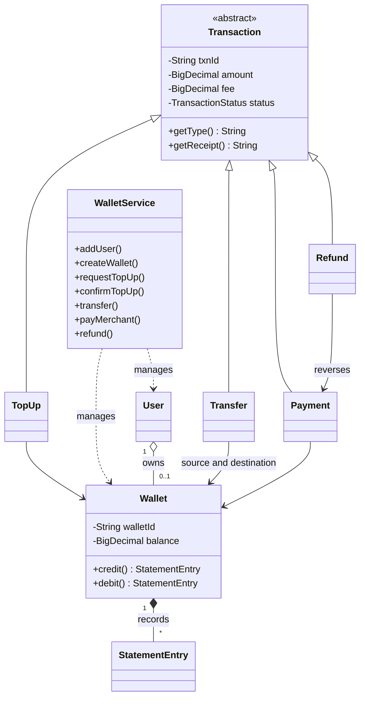

---

## Design Decisions and Assumptions

The specification leaves some details open. These are the choices made in this project:

| Topic | Decision |
|---|---|
| **Transfer fee** | Transfers up to Rs. 1,000.00 are free. Above that, the sender pays a 1% fee (rounded to 2 decimals). The fee is shown on the receipt and as a separate `FEE` line in the statement. Top-ups, payments and refunds have no fee. |
| **Amount limits** | Each transaction must be between Rs. 1.00 and Rs. 50,000.00, with at most 2 decimal places. |
| **Refunds** | A refund returns the full payment amount, only for a payment made from the same wallet, and only once per payment. |
| **Cancelled / failed actions** | A top-up answered with `N`, or an action that is rejected (for example insufficient funds), changes no balance, so it creates no statement entry. |
| **One wallet per user** | Each user can create only one wallet. Users are unique by phone number and by email. |
| **Currency symbol** | `Rs.` is printed instead of the rupee sign, because the Windows CMD often cannot display the rupee symbol correctly. |
| **Storage** | Data is kept in memory only (as in a typical first OOP project). Everything is cleared when you choose **Exit**. |
| **IDs** | Users `U101...`, wallets `W1001...`, transactions `TOP1001`, `TRF1002`, `PAY1003`, `REF1004` ... (one shared counter; a cancelled top-up uses up its number). |
| **Security** | There is no login or PIN. This is a learning project, not a real payment system. |

---

## Testing

All tests use plain Java, so **no JUnit or other download is needed**.

### Automated tests

```bat
test.bat
```

or manually:

```bat
mkdir out
javac -d out -sourcepath src src\main\WalletPlusPlusApp.java
javac -d out -cp out -sourcepath . test\RunAllTests.java
java -cp out test.RunAllTests
```

Each check prints `PASS` or `FAIL`. The last lines show the totals, for example `Result: N passed, 0 failed`. If any check fails, the program ends with exit code 1.

| Test class | What it checks |
|---|---|
| `ValidatorTests` | Name, phone, email, merchant and ID rules; amount limits and formats; the transfer fee rule. |
| `WalletServiceTests` | Every business rule: top-up confirmation and cancellation, transfers with and without fee, insufficient funds (balances unchanged), payments, refunds (valid, repeated, wrong wallet), statement entries, running balance, polymorphic receipts. |
| `ConsoleFlowTests` | Runs the real menu with typed input: a full session through all options, invalid inputs being rejected, and input ending suddenly. |

### Manual test cases

See [`docs/TEST_CASES.md`](docs/TEST_CASES.md) for step-by-step manual test cases with expected results. Two ready-made input files are in `test\sample_input\`:

```bat
java -cp out main.WalletPlusPlusApp < test\sample_input\demo_session.txt
java -cp out main.WalletPlusPlusApp < test\sample_input\invalid_inputs.txt
```

---

## Screenshots

Real **Eclipse Console** screenshots go in the `screenshots` folder. Follow [`docs/SCREENSHOT_GUIDE.md`](docs/SCREENSHOT_GUIDE.md): it lists exactly what to type and which screen to capture for each image below.

| Screenshot | Shows |
|---|---|
| 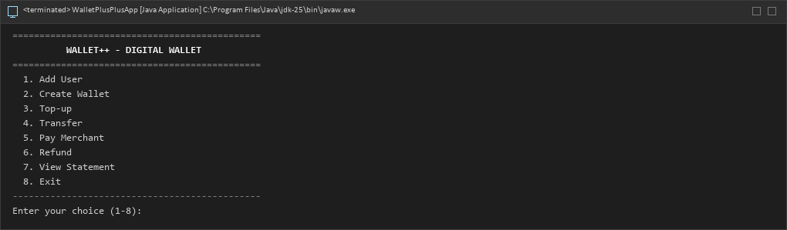 | Main menu |
| 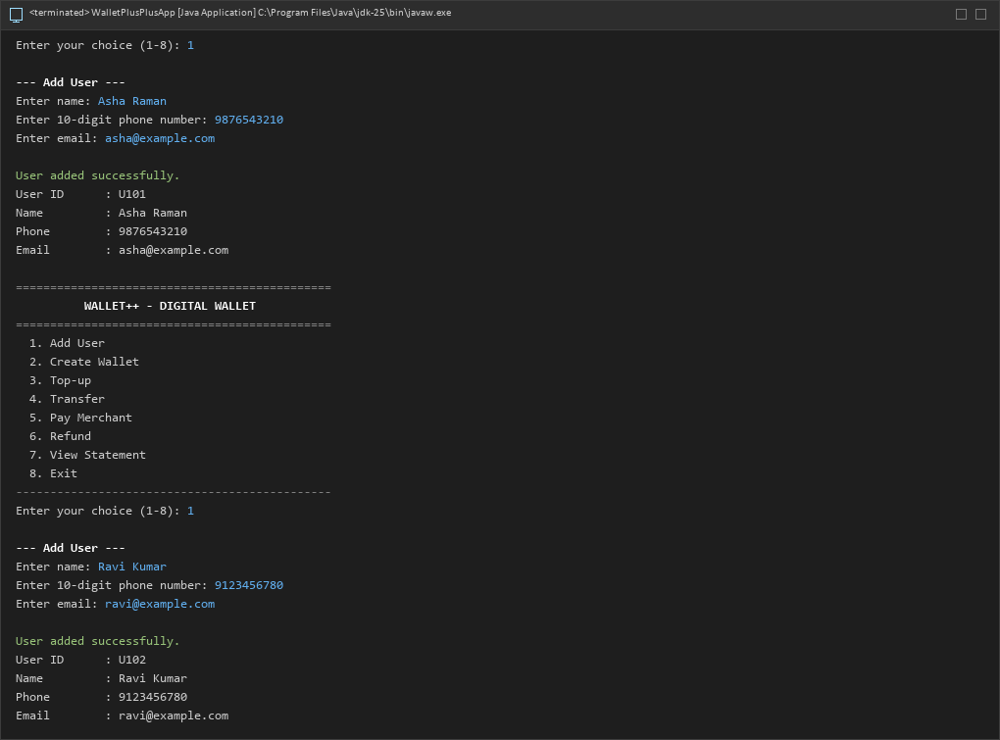 | Add User |
| 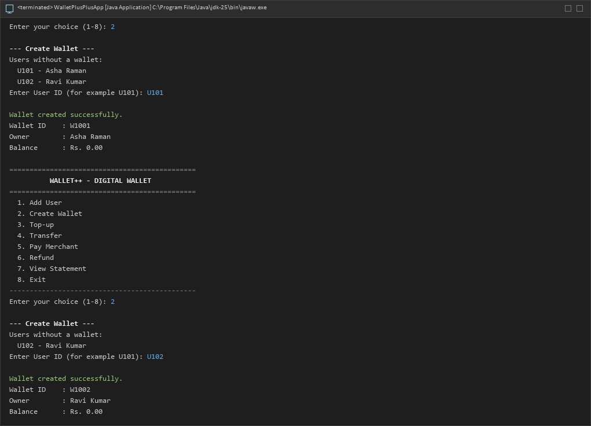 | Create Wallet |
| 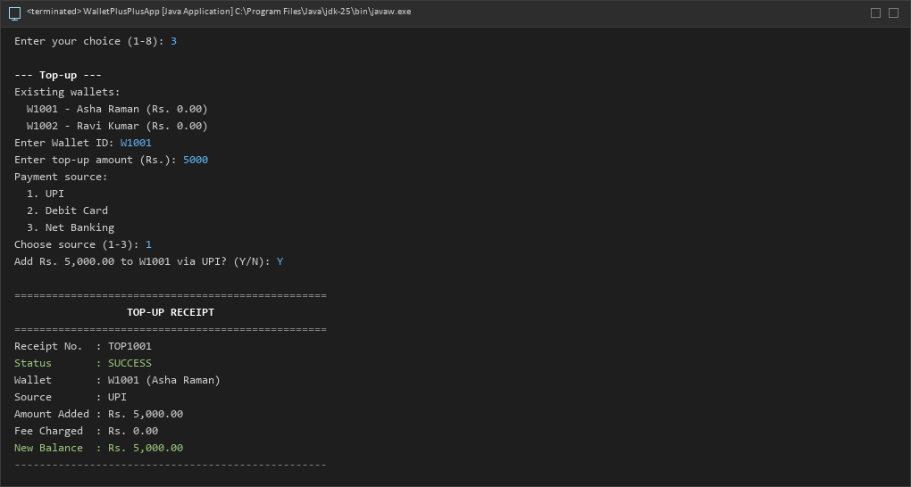 | Top-up with confirmation and receipt |
| 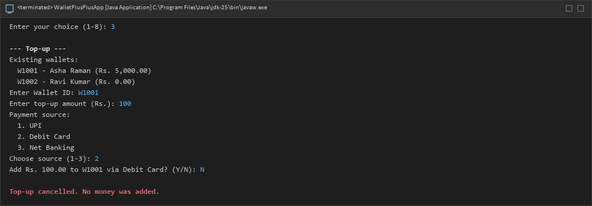 | Top-up cancelled (answer `N`) |
| 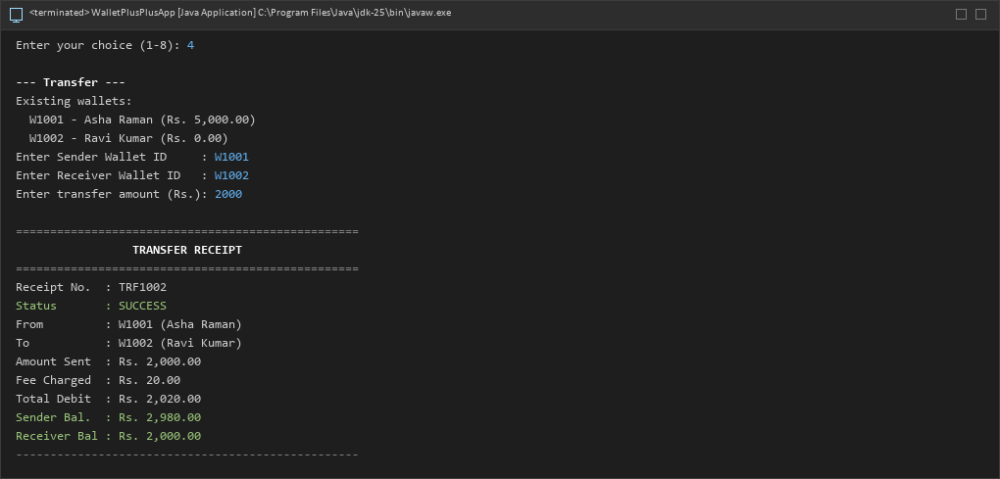 | Transfer receipt with fee and balances |
| 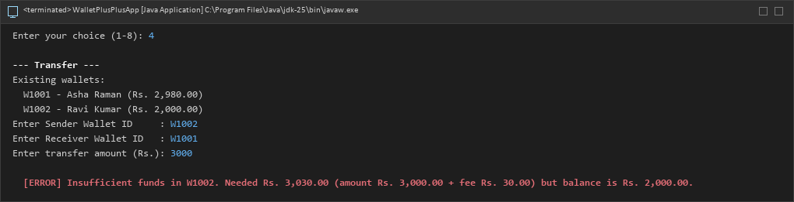 | Insufficient funds error |
| 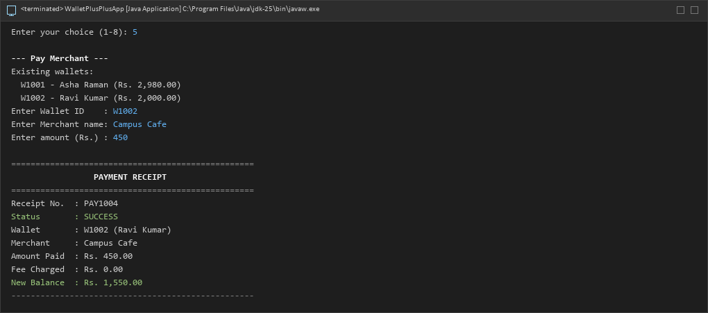 | Pay Merchant receipt |
| 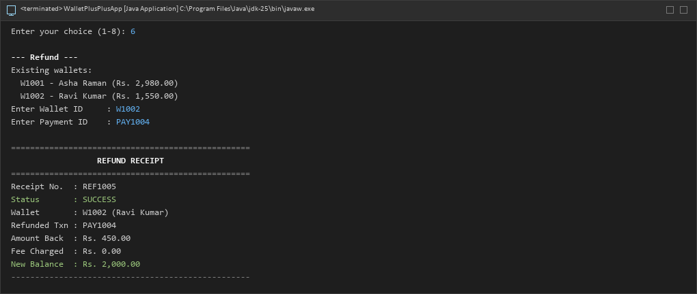 | Refund receipt |
| 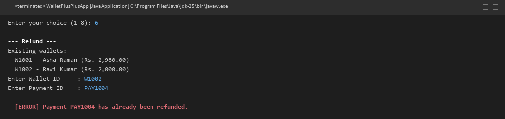 | Second refund rejected |
| 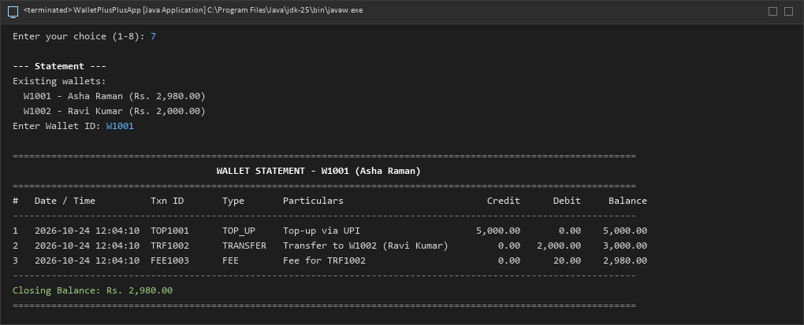 | Statement with running balance (first wallet) |
| 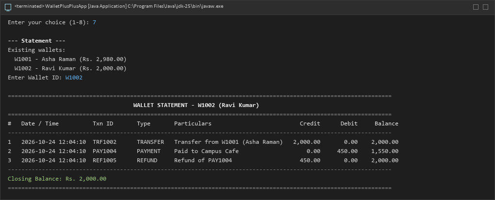 | Statement with running balance (second wallet) |
| 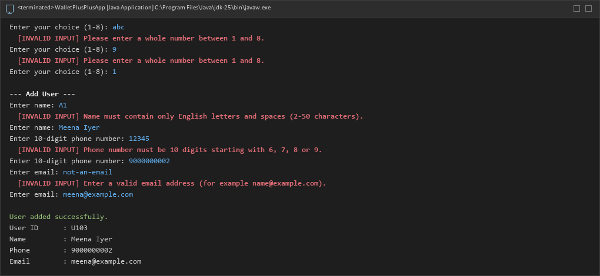 | Validation errors for bad input |
| 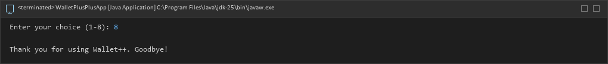 | Exit |

---

## Assignment Details

| | |
|---|---|
| **Course** | 23CSR306 Java Programming |
| **Assignment** | II - OOP Mini Project (any one of 35 specifications) |
| **Chosen specification** | 29 - Digital Wallet & Transfers |
| **Date of issue** | 06-10-2026 |
| **Assessed through** | CO4 / K3: working application and outputs (50 marks). CO5 / K3: OOP design, code quality and viva (50 marks). |
| **Required classes** | User, Wallet, TopUp, Transfer, Payment, Refund, StatementEntry (all present in `src/model`) |
| **Helper classes added** | `Transaction`, `TransactionStatus`, `WalletService`, `Validator`, `InputUtil`, `FeeCalculator`, `Format` and the custom exceptions |
| **Packages** | `model`, `service`, `util`, `exception`, `main` |

---

## Usage Disclaimer

- Wallet++ is an **educational project** made for a college assignment. It **simulates** a wallet; it does **not** connect to any bank, UPI or payment service and never handles real money.
- Data is stored in memory only and there is no login or encryption, so it must **not** be used for real financial data.
- The software is provided "as is", without warranty of any kind (see [LICENSE](LICENSE)).
- If you use this repository for your own coursework, follow your institution's academic-integrity rules, and make sure you understand the code well enough to explain it yourself.

---

## License

Released under the [MIT License](LICENSE). Copyright (c) 2026 `Sriram G S`.
